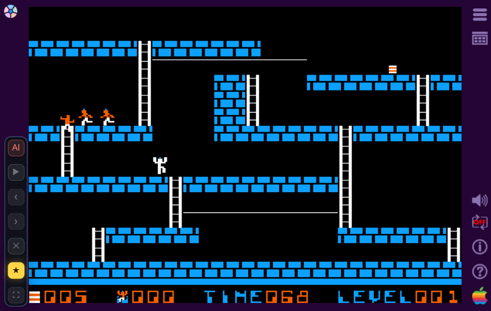
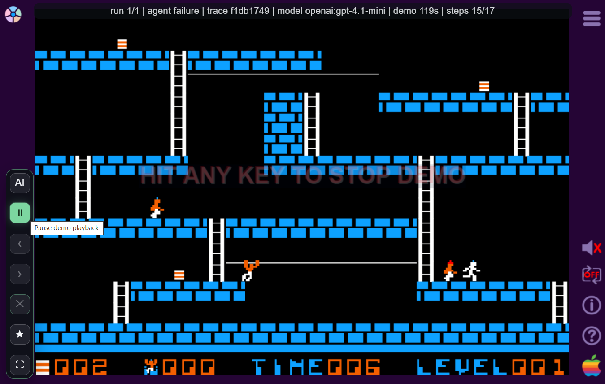

# Mini Runner

Mini Runner lets an LLM play Classic Lode Runner level 1 and lets you replay each decision. The
browser runs the original HTML5 game,
[Lode Runner Total Recall](https://github.com/SimonHung/LodeRunner_TotalRecall). Python proposes
short actions, the model chooses one, and the game determines what happens.

## Getting Started

Install Git, Node.js with npm, and Python 3.11 or later. To run the agent, you also need
credentials for a supported model provider.

```bash
git clone https://github.com/tombay3/mini-runner.git
cd mini-runner
python3 -m venv .venv
source .venv/bin/activate
python -m pip install -r requirements.txt
npm ci
```

Create `.env.local` in the repository root. One example uses the OpenAI profile.

```dotenv
AGENT_MODEL_PROFILE=openai
OPENAI_MODEL=gpt-5-nano
OPENAI_API_KEY=your_openai_api_key
```

The supported profiles are `openai`, `gemini`, `openai-decisions`, and `openrouter`. Keep credentials in the environment
files. Set public controls such as the decision limit, action duration, and history length in
[agent-config.json](public/agent-config.json). To override the profile for one browser page, open
`http://localhost:8283/?profile=gemini`. See
[model profiles and configuration](docs/backend-spec.md#model-profiles).

Run these commands in separate terminals from the repository root.

```bash
npm run api    # Flask on port 8485
```

```bash
npm run dev    # Vite on port 8283
```

Open the [local game](http://localhost:8283). On Classic level 1, **AI** starts or cancels a run.
**Prev** and **Next** select a saved recording. **Play** replays it. During paused playback, press
comma to advance one recorded key segment or period to advance one agent decision. The two
boundaries can differ. [Playback controls](docs/record-playback.md)

## How it works

1. The browser wrapper in `src/` starts the legacy runtime in `public/game/`. Before each decision
   it sends a snapshot and recent action history to Flask.
2. The planner in `agent/` uses terrain, guard motion, gold, and recent progress to generate and
   rank candidates. It filters unsafe moves and confirmed loops before exposing the shortlist.
3. The model requests a `candidateId`. The backend validates it, records the decision, and returns
   a key and tick count. The browser steps the engine. The next snapshot or terminal state shows
   the result.

The agent supports Classic `playData=1`, `level=1`. The engine owns physics, guard behavior, and
completion across the bundled game modes. [Codebase map](docs/codebase.md) ·
[Agent lifecycle](docs/llm-agent.md) · [Candidate rules](docs/candidate-design.md) ·
[Legacy runtime](docs/legacy-runtime.md) · [Game rules](docs/puzzle-game.md)

## Inspect a game run

| File under `__data1/` | What it tells you |
| --- | --- |
| `recordings.json` | Recorded input for playback and pin status. An agent recording shares its ID with its trace. |
| `agent-traces.json` | V4 decisions, including the observed state, exposed candidates, requested and selected IDs, excluded proposals, and issued input. |
| `trace-cohorts.json` | Reviewed findings, comparison groups, launch provenance, and links to archived recording/trace pairs. |
| `agent-debug.log` | The latest ten model I/O entries when `AGENT_DEBUG_LOG=1` is enabled. |
| `metrics.sqlite3` | Measured games, model calls, timing and token usage for comparisons. |

Run `npm run notebook` for comparisons or `npm run dash` to inspect a recording. [Analytics guide](analytics/README.md) · [Cohort and archive workflow](analytics/cohorts.md) · [Trace contract](docs/backend-spec.md#trace-api-and-store)

## Test and evaluate

| Command | Use |
| --- | --- |
| `npm test` | Run fast backend and frontend smoke checks on small fixtures. |
| `npm run test:regression` | Run focused planner, wrapper, and tooling regressions. |
| `npm run data:check` | Check the structure and links in local data stores. |
| `npm run cohorts:check` | Check catalog availability and find complete live pairs awaiting review. |
| `npm run eval -- --smoke` | Check startup in Chrome or Chromium without a model call. |

For real gameplay evaluations, `npm run eval -- --runs 5` starts five attempts using the
configured provider and can incur charges. The hybrid reproducer can replay an existing recording
to a verified decision before testing a continuation. [Test coverage](docs/sanity-tests.md) ·
[Evaluator and reproducer](docs/evaluator.md)
## Screenshots




## Credits

The game runtime is based on
[SimonHung/LodeRunner_TotalRecall](https://github.com/SimonHung/LodeRunner_TotalRecall),
an HTML5 remake of the classic 1983 game ***Lode Runner***.
